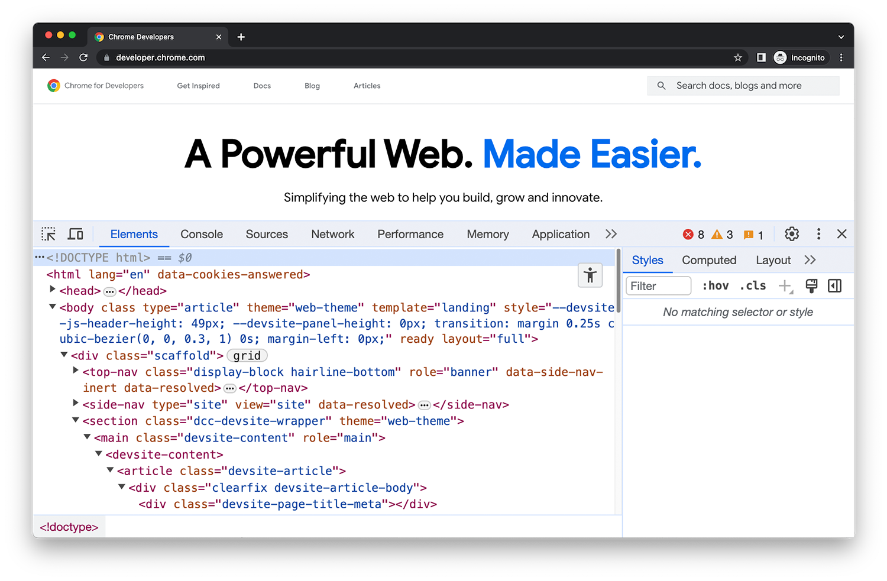

## La investigación de auditoría

<div class="figure-layout"><div><p class="eyebrow">CASO SINTÉTICO AUD-2026-017</p><p class="claim">Varias llamadas sospechosas podrían formar parte de una campaña de suplantación bancaria.</p><p>El equipo investiga qué ocurrió y qué controles debían detectarlo. Empezamos reuniendo información pública que pueda orientar las preguntas.</p><p class="focus">Una publicación pública aporta contexto. Para demostrar qué conocía la entidad necesitaremos además evidencia interna.</p></div><div><p class="source-note">Luis García, Wikimedia Commons. CC BY-SA 2.0. Enlace completo en fuentes.</p></div></div>

## El resultado de esta sesión

<div class="definition"><div><p class="eyebrow">AUTOMATIZACIÓN WEB I · 60 MINUTOS</p><blockquote>Un JSON con publicaciones del Banco de España, su fecha y la procedencia de la extracción.</blockquote><p class="focus">Partimos de la introducción al scraping impartida previamente y aplicamos sus conceptos a una fuente real.</p></div><div class="dimensions"><div><strong>Contenido</strong><p>Fecha publicada, título y URL absoluta.</p></div><div><strong>Procedencia</strong><p>Fuente y momento de recogida.</p></div><div><strong>Integridad</strong><p>SHA-256 de la copia utilizada.</p></div><div><strong>Continuidad</strong><p>La sesión II añadirá histórico y detección de cambios.</p></div></div></div>

## Inspección del documento

<div class="figure-layout"><div><p class="source-note">Chrome for Developers. CC BY 4.0. Captura ilustrativa del inspector.</p></div><div><p class="eyebrow">RECORDATORIO APLICADO</p><p class="claim">El contenedor repetido determina qué consideramos un registro.</p><p>Inspeccionamos fecha, título y enlace. Probamos el selector con varios registros y comprobamos si el contenido llega en el HTML o requiere JavaScript.</p><p class="focus">HTTP transporta la respuesta. BeautifulSoup analiza el HTML recibido. El DOM del navegador puede incluir cambios posteriores de JavaScript.</p></div></div>

## Petición HTTP y contenido dinámico

<div class="contrast"><div><p class="eyebrow">RESPUESTA DEL SERVIDOR</p><p class="claim">requests recibe bytes, cabeceras y un estado HTTP.</p><p>Un 200 indica éxito de la petición, pero podría devolver una página de acceso, un aviso o una estructura inesperada.</p><p>BeautifulSoup analiza el HTML recibido y permite recorrer sus nodos.</p></div><div><p class="eyebrow">PÁGINA DEL NAVEGADOR</p><p class="claim">JavaScript puede modificar el DOM después de recibir el HTML.</p><p>Si los registros no llegan en la respuesta inicial, un selector correcto en el inspector puede devolver cero resultados en Python.</p><p>Primero comprobamos descargas o APIs oficiales. La automatización del navegador se decide según la fuente.</p></div></div>

## Selectores y unidad de observación

<div class="definition"><div><blockquote>Una publicación es nuestra unidad de observación. Cada fila conserva sus campos y su enlace.</blockquote><p class="focus">Buscamos fecha y título dentro del mismo contenedor para evitar combinar datos de publicaciones distintas.</p></div><div class="dimensions"><div><strong>Etiqueta</strong><p><code>article</code> selecciona elementos por su nombre.</p></div><div><strong>Clase</strong><p><code>.publication</code> selecciona una clase CSS.</p></div><div><strong>Descendiente</strong><p><code>.publication-title a</code> encuentra un enlace dentro del título.</p></div><div><strong>Atributo</strong><p><code>a[href]</code> exige que el enlace tenga destino.</p></div></div></div>

## Selectores del Banco de España

La muestra reúne metadatos reales en un índice HTML docente. Sus clases CSS son propias.

:::: {.columns}
::: {.column width="58%"}

```html
<article class="publication">
  <time class="publication-date">24/03/2020</time>
  <h2 class="publication-title">
    <a href="/pcb/es/blog/vishing.html">
      Vishing: llamada telefónica no deseada
    </a>
  </h2>
</article>
```

:::
::: {.column width="42%"}

El parser recorre cada contenedor y busca sus campos dentro de él.

Los enlaces relativos necesitan una URL base. Las fechas se convierten a un tipo definido.

Este índice facilita el aprendizaje. El acceso remoto posterior inspecciona un artículo real con otra estructura.

:::
::::

## Contrato de los registros

:::: {.columns}
::: {.column width="55%"}

```python
class PublicAlert(BaseModel):
    published_date: date
    title: str
    url: HttpUrl
    source_id: str
    collected_at: datetime
```

:::
::: {.column width="45%"}

Pydantic valida fechas, URLs y campos obligatorios.

Un registro incompleto o una extracción vacía debe producir un error visible.

La validación del formato no demuestra que el contenido sea verdadero ni que resulte relevante para el caso.

:::
::::

## Calidad, completitud y relevancia

<div class="process"><div><span>FORMATO</span><strong>¿Es válido?</strong><p>La fecha se interpreta, la URL tiene un formato válido y los campos cumplen el contrato.</p><p>Pydantic hace visibles estos errores.</p></div><div><span>EXTRACCIÓN</span><strong>¿Falta algo?</strong><p>Revisamos campos ausentes, duplicados y registros esperados. Una extracción parcial puede contener filas perfectamente válidas.</p></div><div><span>INVESTIGACIÓN</span><strong>¿Responde a la pregunta?</strong><p>Un título con “llamada” puede orientar la búsqueda. La relevancia para un hallazgo exige revisar el contexto y contrastar evidencia.</p></div></div>

## Procedencia y límites de un hash

<div class="contrast"><div><p class="eyebrow">PROCEDENCIA</p><p class="claim">Conservamos qué fuente usamos y qué transformación aplicamos.</p><p>Distinguimos fecha publicada, fecha de recopilación y creación del artefacto.</p><p>Una selección docente necesita identificar su carácter no exhaustivo.</p></div><div><p class="eyebrow">SHA-256</p><p class="claim">El hash permite comparar una secuencia de bytes con una referencia.</p><p>Un cambio de bytes, incluso de espacios en el HTML, cambia el hash con probabilidad abrumadora.</p><p>El hash por sí solo no acredita autoría, veracidad ni fecha. Necesita acompañarse de procedencia.</p></div></div>

## Acceso responsable a la fuente

<div class="contrast"><div><p class="eyebrow">ANTES DE CONSULTAR</p><p>Revisamos aviso legal, términos de uso, robots.txt y alternativas oficiales como APIs o descargas.</p><p>Definimos el alcance y evitamos datos personales o contenido restringido.</p></div><div><p class="eyebrow">DURANTE LA CONSULTA</p><p>Identificamos el agente, limitamos la frecuencia y usamos tiempos de espera.</p><p>Una respuesta 200 exige comprobar también el contenido. robots.txt expresa preferencias de rastreo y no concede autorización legal.</p></div></div>

## Parte común en el notebook

<div class="process"><div><span>ORIGEN</span><strong>Copia local</strong><p>Leemos el HTML y calculamos su SHA-256. La copia permite repetir la práctica sin depender de cambios externos.</p></div><div><span>EXTRACCIÓN</span><strong>Parser y contrato</strong><p>Extraemos los registros, normalizamos enlaces y fechas y validamos la salida.</p></div><div><span>ARTEFACTO</span><strong>JSON trazable</strong><p>Guardamos las publicaciones y sus metadatos. El acceso remoto queda disponible mediante activación deliberada.</p></div></div>

<p class="notebook-path">Notebook: <code>12_web_scraping_para_auditoria.ipynb</code></p>

## Exploración visual de las publicaciones

<div class="contrast"><div><p class="eyebrow">NUEVE ARTÍCULOS OFICIALES</p><p class="claim">La tabla permite abrir cada fuente y explorar fechas y títulos.</p><p>Buscamos “vishing” o “llamada”, cambiamos el intervalo y seguimos un registro desde su HTML hasta el JSON.</p><p>Una demostración introduce campos ausentes, selectores rotos y duplicados para observar sus efectos.</p></div><div><p class="eyebrow">LECTURA DEL RESULTADO</p><p class="claim">Las barras cuentan publicaciones seleccionadas, no casos de fraude.</p><p>El índice combina artículos de distintos años. Su distribución depende de nuestra selección docente.</p><p>Una coincidencia de palabras orienta la revisión y conserva la regla que la produjo.</p></div></div>

## Ejercicio A o ejercicio B

<div class="contrast"><div><p class="eyebrow">A · DATOS COMUNES</p><p class="claim">Priorizar publicaciones con reglas transparentes.</p><p>Usamos palabras clave para asignar categorías, conservamos los metadatos y explicamos posibles errores de clasificación.</p><p>Dificultad media-baja.</p></div><div><p class="eyebrow">B · FUENTE PROPIA</p><p class="claim">Adaptar el proceso a una URL elegida.</p><p>Justificamos su uso, diseñamos selectores y producimos el mismo contrato, con detección de campos ausentes y duplicados.</p><p>Dificultad alta. Se permite trabajar con IA.</p></div></div>

## Continuidad del expediente

<div class="closing"><p class="claim">La siguiente sesión repetirá la recogida y conservará el histórico de cambios.</p><div><span>Publicaciones</span><span>Llamadas</span><span>Correos</span><span>Controles internos</span></div><p>Gradio reunirá estas evidencias en una interfaz de revisión. Los agentes y el RAG añadirán herramientas y procedimientos citados al expediente.</p></div>

## Fuentes y atribuciones

<div class="sources">

- [Portal del Cliente Bancario: protección frente al fraude](https://clientebancario.bde.es/pcb/es/menu-horizontal/actualidadeducac/educacion-financiera/protegete-contra-el-fraude/)
- [Artículo sobre vishing](https://clientebancario.bde.es/pcb/es/blog/vishing.html), fechas y enlaces de cada publicación en el notebook
- [Aviso legal del Banco de España](https://www.bde.es/wbe/es/pie/aviso-legal/)
- [RFC 9309: Robots Exclusion Protocol](https://www.rfc-editor.org/rfc/rfc9309.html)
- [Chrome DevTools](https://developer.chrome.com/docs/devtools/), captura bajo CC BY 4.0
- [Banco de España, fotografía de Luis García](https://commons.wikimedia.org/wiki/File:Lascar_Banco_de_Espa%C3%B1a_(Bank_of_Spain)_-_Central_Bank_of_Spain_(4607212122).jpg), CC BY-SA 2.0

</div>
